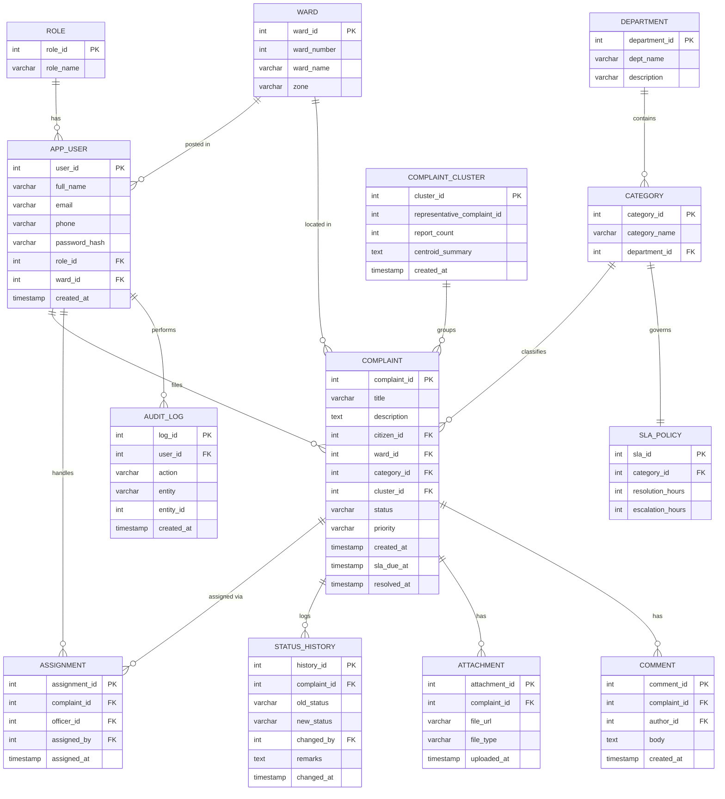

# DBMS Experiential Learning – Level 3 Project
## CivicResolve — Grievance Deduplication & Smart Routing System for Urban Local Bodies

---

## 1. Project Title

**CivicResolve — A Grievance Deduplication & Smart Routing System for Urban Local Bodies (ULBs).**

**Real-world problem addressed:** Municipal grievance portals are flooded with duplicate
complaints (dozens of citizens report the *same* pothole, broken streetlight, or water
leak) and mis-routed tickets (a "sewage overflow" complaint lands in the Roads
department). Staff waste hours manually de-duplicating and re-routing. CivicResolve
uses **semantic similarity search** to (a) automatically detect and merge duplicate
complaints into a single tracked cluster with a "reported by N citizens" count, and
(b) auto-route each new complaint to the correct department/category, with
**SLA-based auto-escalation** when tickets breach their resolution deadline.

This goes well beyond CRUD: the core value is in clustering, semantic routing,
transactional ticket-merging, and SLA enforcement — none of which are simple
create/read/update/delete operations.

---

## 2. Team Formation (2-member team)

| Member | Primary Responsibility | Contribution to Database | Contribution to Application |
|--------|------------------------|--------------------------|------------------------------|
| **Aadish Sarin (PES2UG24CS007)** | Database design & backend | ER modelling, relational schema, DDL, stored procedures, triggers, pgvector setup, embedding pipeline | Next.js API routes (route handlers), DB integration, auth/RBAC |
| **Aditya Alur (PES2UG24CS052)** | Application & UI | Views, indexing, query optimization, data-validation constraints, seed data | Next.js frontend (dashboards, complaint forms, officer console), testing |

Both members contribute to **both** database and application development, as required.

---

## 3. Database Requirement

**Chosen option: Option 2 — SQL + Vector Database.**

| Paradigm | Technology | What it stores | Why this paradigm |
|----------|-----------|----------------|-------------------|
| **Relational (SQL, mandatory)** | **PostgreSQL** | Users, roles, wards, departments, categories, complaints, assignments, status history, SLA policies, audit log | Data is highly **structured and relational** with strong integrity needs — foreign keys between complaints, officers, wards; transactions for ticket assignment; audit trails. ACID guarantees are essential for a government-facing system. |
| **Vector** | **PostgreSQL + pgvector** (extension) | Embeddings of complaint text + metadata | Complaint descriptions are **unstructured free text**. Deduplication and department routing require **semantic similarity** ("streetlight not working" ≈ "lamp post is dark"), which exact-match SQL cannot do. Vector similarity search is the natural fit. |

**Justification (as required by the rubric):** SQL is used because the transactional,
relational backbone (who filed what, assigned to whom, current status, SLA timers) needs
referential integrity and ACID transactions. The vector database is used **only** for the
one thing SQL is bad at — semantic matching of natural-language complaint text. We
deliberately keep both in PostgreSQL (core + `pgvector`) so a single connection and
single transaction can span structured and vector data, avoiding cross-database
consistency problems. The choice is driven by the **nature of the data**, not by
technology demonstration.

> *Note:* pgvector satisfies the "SQL + Vector Database" requirement (two paradigms:
> relational tables + a dedicated vector index type `HNSW`/`IVFFlat`). If the instructor
> requires a physically separate vector engine, the same embeddings can be mirrored into
> **Qdrant** — the schema section documents both.

---

## 4. Database Design

### 4.1 Entities and Attributes (SQL side)

| Entity | Key Attributes |
|--------|----------------|
| **role** | `role_id` (PK), `role_name` |
| **app_user** | `user_id` (PK), `full_name`, `email`, `phone`, `password_hash`, `role_id` (FK→role), `ward_id` (FK→ward, nullable), `created_at` |
| **ward** | `ward_id` (PK), `ward_number`, `ward_name`, `zone` |
| **department** | `department_id` (PK), `dept_name`, `description` |
| **category** | `category_id` (PK), `category_name`, `department_id` (FK→department) |
| **sla_policy** | `sla_id` (PK), `category_id` (FK→category), `resolution_hours`, `escalation_hours` |
| **complaint_cluster** | `cluster_id` (PK), `representative_complaint_id`, `report_count`, `centroid_summary`, `created_at` |
| **complaint** | `complaint_id` (PK), `title`, `description`, `citizen_id` (FK→app_user), `ward_id` (FK→ward), `category_id` (FK→category, nullable at intake), `cluster_id` (FK→complaint_cluster, nullable), `status`, `priority`, `created_at`, `resolved_at`, `sla_due_at` |
| **assignment** | `assignment_id` (PK), `complaint_id` (FK→complaint), `officer_id` (FK→app_user), `assigned_by` (FK→app_user), `assigned_at` |
| **status_history** | `history_id` (PK), `complaint_id` (FK→complaint), `old_status`, `new_status`, `changed_by` (FK→app_user), `remarks`, `changed_at` |
| **attachment** | `attachment_id` (PK), `complaint_id` (FK→complaint), `file_url`, `file_type`, `uploaded_at` |
| **comment** | `comment_id` (PK), `complaint_id` (FK→complaint), `author_id` (FK→app_user), `body`, `created_at` |
| **audit_log** | `log_id` (PK), `user_id` (FK→app_user), `action`, `entity`, `entity_id`, `created_at` |

### 4.2 Relationships

- `role` **1 —— M** `app_user` (a role is held by many users)
- `ward` **1 —— M** `app_user` (officers belong to a ward); `ward` **1 —— M** `complaint`
- `department` **1 —— M** `category`
- `category` **1 —— M** `complaint`; `category` **1 —— 1** `sla_policy`
- `app_user` (citizen) **1 —— M** `complaint`
- `complaint_cluster` **1 —— M** `complaint` (many duplicate complaints roll up to one cluster)
- `complaint` **1 —— M** `assignment`, `status_history`, `attachment`, `comment`
- `app_user` (officer) **1 —— M** `assignment`

### 4.3 ER Diagram (Mermaid — renders on GitHub; also drawn in report)



### 4.4 Relational Schema (textual)

```
role(role_id PK, role_name)
ward(ward_id PK, ward_number, ward_name, zone)
department(department_id PK, dept_name, description)
category(category_id PK, category_name, department_id FK→department)
sla_policy(sla_id PK, category_id FK→category, resolution_hours, escalation_hours)
app_user(user_id PK, full_name, email, phone, password_hash,
         role_id FK→role, ward_id FK→ward, created_at)
complaint_cluster(cluster_id PK, representative_complaint_id, report_count,
                  centroid_summary, created_at)
complaint(complaint_id PK, title, description, citizen_id FK→app_user,
          ward_id FK→ward, category_id FK→category, cluster_id FK→complaint_cluster,
          status, priority, created_at, sla_due_at, resolved_at)
assignment(assignment_id PK, complaint_id FK→complaint, officer_id FK→app_user,
           assigned_by FK→app_user, assigned_at)
status_history(history_id PK, complaint_id FK→complaint, old_status, new_status,
               changed_by FK→app_user, remarks, changed_at)
attachment(attachment_id PK, complaint_id FK→complaint, file_url, file_type, uploaded_at)
comment(comment_id PK, complaint_id FK→complaint, author_id FK→app_user, body, created_at)
audit_log(log_id PK, user_id FK→app_user, action, entity, entity_id, created_at)
```

### 4.5 Vector Component — Data Model & Retrieval Strategy

| Item | Design decision |
|------|-----------------|
| **What is embedded** | The concatenated `title + description` of each complaint (the free-text citizen report). |
| **Embedding model** | `sentence-transformers/all-MiniLM-L6-v2` → **384-dimension** vectors (fast, runs locally, good for short text). |
| **Where vectors are stored** | pgvector column `embedding vector(384)` in table `complaint_vector` (mirrors `complaint_id`); optional Qdrant collection `complaints` with the same payload. |
| **Metadata stored with vector** | `complaint_id`, `ward_id`, `category_id`, `status`, `created_at` — used to filter similarity search (e.g., only search within the same ward for dedup). |
| **Index** | `HNSW` index (`vector_cosine_ops`) for approximate nearest-neighbour search. |
| **Similarity metric** | **Cosine similarity** (text embeddings are direction-sensitive, not magnitude-sensitive). |
| **Retrieval — Deduplication** | On new complaint: embed → search top-k within same ward → if best cosine similarity ≥ **0.85**, treat as duplicate and attach to that complaint's cluster (increment `report_count`); else create a new cluster. |
| **Retrieval — Smart routing** | Compare the new complaint's embedding against category "centroid" examples → assign the `category_id` (and thus `department_id`) of the nearest category. |

**Vector document (Qdrant mirror) shape:**
```json
{
  "id": 10231,
  "vector": [0.021, -0.114, ...],        // 384 floats
  "payload": {
    "complaint_id": 10231,
    "ward_id": 7,
    "category_id": 3,
    "status": "OPEN",
    "created_at": "2026-08-24T09:15:00Z"
  }
}
```

---

## 5. SQL Implementation (DDL)

> PostgreSQL. Demonstrates `CREATE`, `ALTER`, `DROP`, primary/foreign keys,
> constraints, indexes, a view, and the pgvector extension.

```sql
-- ============================================================
-- CivicResolve — Schema DDL (PostgreSQL + pgvector)
-- ============================================================

-- Clean start (DROP demonstration)
DROP VIEW  IF EXISTS v_department_open_load CASCADE;
DROP TABLE IF EXISTS audit_log, comment, attachment, status_history,
                     assignment, complaint_vector, complaint,
                     complaint_cluster, sla_policy, category,
                     department, app_user, ward, role CASCADE;

-- Enable vector support
CREATE EXTENSION IF NOT EXISTS vector;

-- ---------- Lookup / master tables ----------
CREATE TABLE role (
    role_id     SERIAL PRIMARY KEY,
    role_name   VARCHAR(20) NOT NULL UNIQUE
                CHECK (role_name IN ('CITIZEN','OFFICER','ADMIN'))
);

CREATE TABLE ward (
    ward_id     SERIAL PRIMARY KEY,
    ward_number INT NOT NULL UNIQUE,
    ward_name   VARCHAR(80) NOT NULL,
    zone        VARCHAR(40) NOT NULL
);

CREATE TABLE department (
    department_id SERIAL PRIMARY KEY,
    dept_name     VARCHAR(80) NOT NULL UNIQUE,
    description   VARCHAR(255)
);

CREATE TABLE category (
    category_id   SERIAL PRIMARY KEY,
    category_name VARCHAR(80) NOT NULL,
    department_id INT NOT NULL,
    CONSTRAINT fk_category_dept
        FOREIGN KEY (department_id) REFERENCES department(department_id),
    CONSTRAINT uq_category UNIQUE (category_name, department_id)
);

CREATE TABLE sla_policy (
    sla_id           SERIAL PRIMARY KEY,
    category_id      INT NOT NULL UNIQUE,
    resolution_hours INT NOT NULL CHECK (resolution_hours > 0),
    escalation_hours INT NOT NULL CHECK (escalation_hours > 0),
    CONSTRAINT fk_sla_category
        FOREIGN KEY (category_id) REFERENCES category(category_id)
);

-- ---------- Users ----------
CREATE TABLE app_user (
    user_id       SERIAL PRIMARY KEY,
    full_name     VARCHAR(100) NOT NULL,
    email         VARCHAR(120) NOT NULL UNIQUE,
    phone         VARCHAR(15)  CHECK (phone ~ '^[0-9]{10}$'),
    password_hash VARCHAR(255) NOT NULL,             -- bcrypt hash, never plaintext
    role_id       INT NOT NULL,
    ward_id       INT,                               -- officers belong to a ward
    created_at    TIMESTAMP NOT NULL DEFAULT NOW(),
    CONSTRAINT fk_user_role FOREIGN KEY (role_id) REFERENCES role(role_id),
    CONSTRAINT fk_user_ward FOREIGN KEY (ward_id) REFERENCES ward(ward_id)
);

-- ---------- Clusters (duplicate rollups) ----------
CREATE TABLE complaint_cluster (
    cluster_id                SERIAL PRIMARY KEY,
    representative_complaint_id INT,                 -- set after first complaint exists
    report_count              INT NOT NULL DEFAULT 1 CHECK (report_count >= 1),
    centroid_summary          TEXT,
    created_at                TIMESTAMP NOT NULL DEFAULT NOW()
);

-- ---------- Core: complaints ----------
CREATE TABLE complaint (
    complaint_id SERIAL PRIMARY KEY,
    title        VARCHAR(150) NOT NULL,
    description  TEXT NOT NULL,
    citizen_id   INT NOT NULL,
    ward_id      INT NOT NULL,
    category_id  INT,                                -- NULL at intake, set by routing
    cluster_id   INT,
    status       VARCHAR(20) NOT NULL DEFAULT 'OPEN'
                 CHECK (status IN ('OPEN','ASSIGNED','IN_PROGRESS','RESOLVED','CLOSED','ESCALATED')),
    priority     VARCHAR(10) NOT NULL DEFAULT 'MEDIUM'
                 CHECK (priority IN ('LOW','MEDIUM','HIGH')),
    created_at   TIMESTAMP NOT NULL DEFAULT NOW(),
    sla_due_at   TIMESTAMP,
    resolved_at  TIMESTAMP,
    CONSTRAINT fk_complaint_citizen  FOREIGN KEY (citizen_id) REFERENCES app_user(user_id),
    CONSTRAINT fk_complaint_ward      FOREIGN KEY (ward_id)     REFERENCES ward(ward_id),
    CONSTRAINT fk_complaint_category  FOREIGN KEY (category_id) REFERENCES category(category_id),
    CONSTRAINT fk_complaint_cluster   FOREIGN KEY (cluster_id)  REFERENCES complaint_cluster(cluster_id),
    CONSTRAINT chk_resolved_after_created CHECK (resolved_at IS NULL OR resolved_at >= created_at)
);

-- Add the deferred FK from cluster -> representative complaint (ALTER demonstration)
ALTER TABLE complaint_cluster
    ADD CONSTRAINT fk_cluster_rep_complaint
    FOREIGN KEY (representative_complaint_id) REFERENCES complaint(complaint_id);

-- ---------- Vector store (pgvector) ----------
CREATE TABLE complaint_vector (
    complaint_id INT PRIMARY KEY,
    embedding    vector(384) NOT NULL,
    CONSTRAINT fk_vec_complaint FOREIGN KEY (complaint_id)
        REFERENCES complaint(complaint_id) ON DELETE CASCADE
);

-- ---------- Workflow tables ----------
CREATE TABLE assignment (
    assignment_id SERIAL PRIMARY KEY,
    complaint_id  INT NOT NULL,
    officer_id    INT NOT NULL,
    assigned_by   INT NOT NULL,
    assigned_at   TIMESTAMP NOT NULL DEFAULT NOW(),
    CONSTRAINT fk_assign_complaint FOREIGN KEY (complaint_id) REFERENCES complaint(complaint_id),
    CONSTRAINT fk_assign_officer   FOREIGN KEY (officer_id)   REFERENCES app_user(user_id),
    CONSTRAINT fk_assign_by        FOREIGN KEY (assigned_by)  REFERENCES app_user(user_id)
);

CREATE TABLE status_history (
    history_id   SERIAL PRIMARY KEY,
    complaint_id INT NOT NULL,
    old_status   VARCHAR(20),
    new_status   VARCHAR(20) NOT NULL,
    changed_by   INT NOT NULL,
    remarks      TEXT,
    changed_at   TIMESTAMP NOT NULL DEFAULT NOW(),
    CONSTRAINT fk_hist_complaint FOREIGN KEY (complaint_id) REFERENCES complaint(complaint_id),
    CONSTRAINT fk_hist_user      FOREIGN KEY (changed_by)   REFERENCES app_user(user_id)
);

CREATE TABLE attachment (
    attachment_id SERIAL PRIMARY KEY,
    complaint_id  INT NOT NULL,
    file_url      VARCHAR(255) NOT NULL,
    file_type     VARCHAR(20),
    uploaded_at   TIMESTAMP NOT NULL DEFAULT NOW(),
    CONSTRAINT fk_att_complaint FOREIGN KEY (complaint_id) REFERENCES complaint(complaint_id)
);

CREATE TABLE comment (
    comment_id   SERIAL PRIMARY KEY,
    complaint_id INT NOT NULL,
    author_id    INT NOT NULL,
    body         TEXT NOT NULL,
    created_at   TIMESTAMP NOT NULL DEFAULT NOW(),
    CONSTRAINT fk_comment_complaint FOREIGN KEY (complaint_id) REFERENCES complaint(complaint_id),
    CONSTRAINT fk_comment_author    FOREIGN KEY (author_id)    REFERENCES app_user(user_id)
);

CREATE TABLE audit_log (
    log_id     SERIAL PRIMARY KEY,
    user_id    INT,
    action     VARCHAR(50) NOT NULL,
    entity     VARCHAR(40) NOT NULL,
    entity_id  INT,
    created_at TIMESTAMP NOT NULL DEFAULT NOW(),
    CONSTRAINT fk_audit_user FOREIGN KEY (user_id) REFERENCES app_user(user_id)
);

-- ============================================================
-- Indexes
-- ============================================================
CREATE INDEX idx_complaint_status    ON complaint(status);
CREATE INDEX idx_complaint_ward       ON complaint(ward_id);
CREATE INDEX idx_complaint_category   ON complaint(category_id);
CREATE INDEX idx_complaint_created    ON complaint(created_at);
CREATE INDEX idx_assignment_officer   ON assignment(officer_id);

-- Vector similarity index (cosine, HNSW)
CREATE INDEX idx_complaint_embedding
    ON complaint_vector USING hnsw (embedding vector_cosine_ops);

-- ============================================================
-- View: live open-complaint load per department
-- ============================================================
CREATE VIEW v_department_open_load AS
SELECT  d.department_id,
        d.dept_name,
        COUNT(c.complaint_id) AS open_complaints
FROM    department d
JOIN    category  cat ON cat.department_id = d.department_id
JOIN    complaint c   ON c.category_id     = cat.category_id
WHERE   c.status IN ('OPEN','ASSIGNED','IN_PROGRESS','ESCALATED')
GROUP BY d.department_id, d.dept_name
ORDER BY open_complaints DESC;
```

### DDL feature coverage (for the report checklist)

| Requirement (point 5) | Where demonstrated |
|-----------------------|--------------------|
| `CREATE` | all `CREATE TABLE` / `CREATE VIEW` / `CREATE INDEX` |
| `ALTER`  | deferred FK on `complaint_cluster` |
| `DROP`   | clean-start block at top |
| Primary keys | every table |
| Foreign keys | complaint, assignment, category, etc. |
| Constraints | `CHECK` (status, priority, phone regex), `UNIQUE`, `NOT NULL` |
| Indexes | 5 B-tree + 1 HNSW vector index |
| Views | `v_department_open_load` |

---

*Points 6–18 (DML operations, the 4+ advanced features — trigger for SLA
auto-escalation, stored procedure for atomic duplicate-merge, transactions, vector
similarity search — Next.js UI, auth/RBAC, etc.) will be completed in the next phase.*
